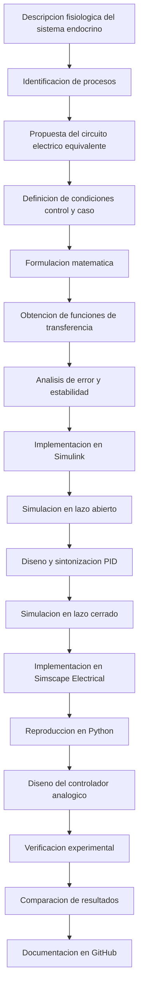

[](https://matlab.mathworks.com/)

# Práctica 4 — Modelo y control del sistema endócrino

Repositorio académico de la asignatura **Modelado de Sistemas Fisiológicos**, correspondiente al programa de **Ingeniería Biomédica** del Tecnológico Nacional de México / Instituto Tecnológico de Tijuana. Esta práctica integra modelado matemático, analogías eléctricas de sistemas fisiológicos, análisis del comportamiento dinámico, diseño de controladores PID y simulación computacional.

El caso de estudio representa de manera fenomenológica el **sistema endócrino**, considerando los procesos de secreción, transporte, almacenamiento y respuesta hormonal. Mediante una analogía eléctrica se propone un circuito equivalente de segundo orden, el cual permite comparar una condición de referencia (control) con una condición alterada (caso), diseñar un controlador PID y analizar las respuestas obtenidas mediante diferentes herramientas computacionales.

**Docente:** Dr. Paul Antonio Valle Trujillo  
**Correo:** paul.valle@tectijuana.edu.mx  
**Departamento:** Ingeniería Eléctrica y Electrónica  
**Institución:** Tecnológico Nacional de México / Instituto Tecnológico de Tijuana  
**Asignatura:** Modelado de Sistemas Fisiológicos  
**Programa:** Ingeniería Biomédica  
**Estudiante:** Katherine Coria Camacho · 23212189 · l23212189@tijuana.tecnm.mx

**Repositorio de la asignatura:** [Modelado de Sistemas Fisiológicos — GitHub](https://github.com/DrPaulValle/MSF-IBF1020)

**Sede:** Blvd. Alberto Limón Padilla s/n, Tijuana, C. P. 22454, B. C., México.

---

<a id="contenido"></a>
## Contenido

1. [Resumen](#resumen)
2. [Competencia y objetivos](#objetivos)
3. [Relación con el temario](#temario)
4. [Modelo fisiológico y analogía eléctrica](#analogia)
5. [Diagrama del sistema endócrino](#diagrama)
6. [Formulación matemática](#modelo)
7. [Análisis temporal y de estabilidad](#analisis)
8. [Señales de entrada y condiciones de simulación](#senales)
9. [Implementación en MATLAB, Simulink y Simscape](#matlab)
10. [Control en lazo cerrado y sintonización PID](#pid)
11. [Reproducción en Python](#python)
12. [Diseño del controlador analógico](#laboratorio)
13. [Resultados y verificación cruzada](#resultados)
14. [Flujo de trabajo](#flujo)
15. [Actividades del estudiante](#actividades)
16. [Estructura del repositorio](#estructura)
17. [Requisitos](#requisitos)
18. [Reproducibilidad y entregables](#reproducibilidad)
19. [Referencias](#referencias)

---

<a id="resumen"></a>
## Resumen

La práctica tiene como propósito **modelar, analizar y controlar un sistema endócrino mediante una analogía eléctrica**, considerando de manera simplificada los procesos de secreción, transporte, almacenamiento y respuesta hormonal.

Para representar estos procesos se propone un circuito eléctrico equivalente de segundo orden, compuesto por una resistencia $R_1$, una capacitancia $C$, una inductancia $L$ y una resistencia $R_2$. Estos elementos permiten representar fenomenológicamente las pérdidas durante el transporte hormonal, la acumulación temporal de la señal y la dinámica de respuesta del tejido u órgano diana.

El modelo contempla dos condiciones de estudio: una condición de referencia denominada **control** y una condición alterada denominada **caso**. A partir de los valores asignados a cada componente eléctrico, se obtienen las funciones de transferencia correspondientes y se analiza su comportamiento ante una entrada escalón unitario.

Posteriormente, se incorpora un controlador PID con el propósito de reducir la diferencia entre la respuesta del caso y la respuesta de referencia. La implementación se desarrolla mediante MATLAB, Simulink, Simscape Electrical y Python. Finalmente, se plantea la construcción experimental de los circuitos y del controlador analógico para comparar los resultados de simulación con las mediciones de laboratorio.

**Palabras clave:** Sistema endócrino; Modelado matemático; Función de transferencia; Analogía eléctrica; Control PID.

[Volver al contenido](#contenido)

---

<a id="objetivos"></a>
## Competencia y objetivos

### Competencia a desarrollar

Modelizar sistemas fisiológicos mediante analogías eléctricas, ecuaciones diferenciales y funciones de transferencia para analizar su comportamiento dinámico y diseñar estrategias de control mediante técnicas de control clásico.

En particular, la práctica permite interpretar una descripción simplificada de los procesos de secreción, transporte, almacenamiento y respuesta hormonal para proponer un circuito eléctrico equivalente de segundo orden. Posteriormente, se comparan una condición de referencia y una condición alterada, se diseña un controlador PID y se contrastan los resultados obtenidos mediante modelado analítico, simulación computacional y experimentación.

### Objetivo general

Desarrollar el modelo matemático y el circuito eléctrico equivalente de un sistema endócrino simplificado, mediante la aplicación de analogías eléctricas y funciones de transferencia, para analizar su comportamiento dinámico y diseñar un controlador PID que permita aproximar la respuesta de una condición alterada a una respuesta de referencia.

### Objetivos específicos

- Interpretar los procesos de secreción, transporte, almacenamiento y respuesta hormonal.
- Identificar los elementos eléctricos que conforman el modelo del sistema endócrino.
- Construir los circuitos equivalentes correspondientes a las condiciones control y caso.
- Obtener las funciones de transferencia de ambas condiciones.
- Analizar el error en estado estacionario ante una entrada escalón unitario.
- Calcular los polos y determinar la estabilidad de los sistemas.
- Formular las ecuaciones integro-diferenciales mediante las leyes de Kirchhoff.
- Implementar los modelos en MATLAB, Simulink y Simscape Electrical.
- Incorporar un controlador PID para reducir la diferencia entre las respuestas.
- Obtener las ganancias del controlador mediante la herramienta Tune.
- Reproducir los modelos mediante Python y comparar los resultados.
- Diseñar un controlador analógico mediante amplificadores operacionales.
- Contrastar los resultados de simulación con las respuestas experimentales.

[Volver al contenido](#contenido)

---

<a id="temario"></a>
## Relación con el temario

La práctica integra contenidos correspondientes a la asignatura **Modelado de Sistemas Fisiológicos (IBF-1020)**:

| Unidad | Área | Contenidos aplicados |
|---|---|---|
| I | Sistemas de control retroalimentados | Elementos de un sistema de control, diagramas de bloques y retroalimentación negativa |
| II | Modelado matemático | Representación de sistemas fisiológicos, analogías eléctricas, ecuaciones diferenciales y funciones de transferencia |
| III | Controladores | Diseño, sintonización e implementación de controladores PID |

El enfoque combina **Ingeniería Biomédica, Electrónica, Modelado Matemático y Teoría de Control**, mediante el estudio de un modelo fenomenológico del sistema endócrino y su representación mediante circuitos eléctricos equivalentes.

[Volver al contenido](#contenido)

---

<a id="analogia"></a>
## Modelo fisiológico y analogía eléctrica

El sistema endócrino participa en la regulación de diferentes procesos fisiológicos mediante la liberación de hormonas producidas por glándulas especializadas. Una vez secretadas, estas moléculas son transportadas mediante la circulación hasta los tejidos u órganos diana, donde interactúan con receptores específicos y producen respuestas fisiológicas.

Para estudiar estos procesos mediante herramientas de modelado y control, se utiliza una representación fenomenológica simplificada. El modelo no representa un eje hormonal específico ni establece una equivalencia directa entre los componentes eléctricos y parámetros fisiológicos medidos experimentalmente. Su finalidad es reproducir cualitativamente propiedades dinámicas como el almacenamiento, la disipación, el retardo y la inercia de la respuesta.

El circuito equivalente está compuesto por los siguientes elementos:

- **Fuente de voltaje $V_e(t)$:** representa el estímulo fisiológico que inicia la secreción hormonal.
- **Resistencia $R_1$:** representa la oposición efectiva y las pérdidas asociadas con el transporte de la señal hormonal.
- **Capacitancia $C$:** representa la capacidad de almacenamiento temporal de la señal hormonal.
- **Inductancia $L$:** representa fenomenológicamente el retardo o la inercia de la respuesta del tejido diana.
- **Resistencia $R_2$:** representa la oposición efectiva asociada con la utilización, disipación o eliminación de la señal hormonal.

Las variables principales del modelo son:

| Variable | Descripción |
|---|---|
| $V_e(t)$ | Estímulo que activa la respuesta del sistema endócrino |
| $F_e(t)$ | Flujo asociado con la secreción y el transporte hormonal |
| $F_s(t)$ | Flujo asociado con la utilización o respuesta del órgano diana |
| $V_s(t)$ | Nivel efectivo y normalizado de la señal hormonal disponible |

### Analogía eléctrica

La representación del sistema se construye mediante una rama principal formada por la fuente $V_e(t)$ y la resistencia $R_1$. Después de esta resistencia se encuentra un nodo donde se conectan en paralelo una capacitancia $C$ y una segunda rama constituida por la inductancia $L$ y la resistencia $R_2$ en serie.

La salida $V_s(t)$ se mide en el nodo de unión entre $R_1$, $C$ y $L$.

| Proceso fisiológico | Representación eléctrica | Interpretación dentro del modelo |
|---|---|---|
| Estímulo para la secreción hormonal | $V_e(t)$ | Señal de entrada que activa la respuesta del sistema |
| Flujo de secreción y transporte hormonal | $F_e(t)$ | Corriente asociada con la transferencia de la señal |
| Pérdidas y oposición durante el transporte | $R_1$ | Oposición efectiva a la transmisión de la señal |
| Acumulación temporal de hormona | $C$ | Capacidad de almacenamiento temporal |
| Retardo o inercia de la respuesta del tejido diana | $L$ | Resistencia dinámica a cambios rápidos |
| Utilización, disipación o eliminación de la señal | $R_2$ | Oposición efectiva asociada con la utilización de la señal |
| Flujo asociado con la respuesta del tejido diana | $F_s(t)$ | Corriente correspondiente a la rama de respuesta |
| Nivel hormonal efectivo | $V_s(t)$ | Variable de salida normalizada |

> **Alcance de la analogía:** las correspondencias anteriores constituyen una representación fenomenológica con fines académicos. Los valores de los componentes eléctricos no representan directamente magnitudes fisiológicas del sistema endócrino.

### Valores de los componentes

Para el desarrollo de la práctica se consideran dos condiciones:

| Componente | Control | Caso |
|---|---:|---:|
| $R_1$ | $1\,k\Omega$ | $1\,k\Omega$ |
| $L$ | $100\,mH$ | $100\,mH$ |
| $C$ | $1\,\mu F$ | $1000\,\mu F$ |
| $R_2$ | $100\,k\Omega$ | $1\,k\Omega$ |

La modificación de los valores de capacitancia y resistencia permite estudiar las diferencias en el almacenamiento, la disipación y la respuesta temporal del sistema.

[Volver al contenido](#contenido)

---

<a id="diagrama"></a>
## Diagrama del sistema endócrino

El circuito eléctrico equivalente se construye a partir de la descripción funcional del sistema endócrino. La representación debe mostrar la fuente de entrada, la resistencia de transporte, el capacitor conectado a la referencia y la rama formada por el inductor y la resistencia de salida.

El diagrama debe identificar los siguientes elementos:

1. Entrada $V_e(t)$.
2. Salida $V_s(t)$.
3. Resistencia $R_1$.
4. Capacitancia $C$.
5. Inductancia $L$.
6. Resistencia $R_2$.
7. Flujo de entrada $F_e(t)$.
8. Flujo de salida $F_s(t)$.
9. Nodos principales y referencia eléctrica.

Se deben representar las dos condiciones del modelo: control y caso.


[Volver al contenido](#contenido)

---

<a id="modelo"></a>
## Formulación matemática

### 1. Relaciones eléctricas del sistema

El circuito equivalente se analiza mediante las leyes de Kirchhoff, considerando la conexión en paralelo entre la capacitancia $C$ y la rama formada por la inductancia $L$ y la resistencia $R_2$.

La corriente de entrada se distribuye entre la corriente del capacitor y la corriente de la rama de salida:

$$
F_e(t)=F_C(t)+F_s(t)
$$

La relación entre el voltaje de entrada, la resistencia $R_1$ y el voltaje de salida se expresa como:

$$
V_e(t)=R_1F_e(t)+V_s(t)
$$

Para la capacitancia se utiliza la relación:

$$
F_C(t)=C\frac{dV_s(t)}{dt}
$$

Para la rama formada por la inductancia y la resistencia $R_2$:

$$
V_s(t)=L\frac{dF_s(t)}{dt}+R_2F_s(t)
$$

### 2. Obtención de la función de transferencia

Sustituyendo las relaciones anteriores en la ecuación de entrada:

$$
V_e(t)=R_1\left(C\frac{dV_s(t)}{dt}+F_s(t)\right)+V_s(t)
$$

Aplicando la transformada de Laplace, considerando condiciones iniciales nulas:

$$
V_e(s)=R_1CsV_s(s)+R_1F_s(s)+V_s(s)
$$

De la rama formada por el inductor y la resistencia:

$$
V_s(s)=LsF_s(s)+R_2F_s(s)
$$

Despejando la corriente de salida:

$$
F_s(s)=\frac{V_s(s)}{Ls+R_2}
$$

Sustituyendo en la ecuación de entrada:

$$
V_e(s)=R_1CsV_s(s)+
R_1\frac{V_s(s)}{Ls+R_2}+V_s(s)
$$

Agrupando términos:

$$
V_e(s)(Ls+R_2)=
V_s(s)\left[R_1CLs^2+(R_1CR_2+L)s+(R_1+R_2)\right]
$$

Finalmente, despejando la relación entre la salida y la entrada:

$$
\boxed{ G(s)=\frac{V_s(s)}{V_e(s)} =
\frac{Ls+R_2}
{R_1CLs^2+(R_1CR_2+L)s+(R_1+R_2)}
}
$$

### 3. Función de transferencia para la condición control

Para la condición control se utilizan los valores:

$$
R_1=1000\,\Omega
$$

$$
C=1\times10^{-6}\,F
$$

$$
L=0.1\,H
$$

$$
R_2=100000\,\Omega
$$

Sustituyendo en la función de transferencia:

$$
G_{control}(s)=
\frac{0.1s+100000}
{0.0001s^2+100.1s+101000}
$$

### 4. Función de transferencia para la condición caso

Para la condición caso se utilizan los valores:

$$
R_1=1000\,\Omega
$$

$$
C=1000\times10^{-6}\,F
$$

$$
L=0.1\,H
$$

$$
R_2=1000\,\Omega
$$

Sustituyendo en la función de transferencia:

$$
G_{caso}(s)=
\frac{0.1s+1000}
{0.1s^2+1000.1s+2000}
$$

### 5. Orden de los sistemas

Las funciones de transferencia obtenidas son de segundo orden debido a la presencia de dos elementos independientes de almacenamiento de energía: la capacitancia $C$ y la inductancia $L$.

Por lo tanto, ambos modelos presentan dos polos, cuya ubicación depende de los valores de los componentes eléctricos utilizados.

[Volver al contenido](#contenido)

---

<a id="analisis"></a>
## Análisis temporal y de estabilidad

El análisis temporal y de estabilidad permite estudiar las diferencias entre las condiciones control y caso, considerando la respuesta del sistema ante una entrada escalón unitario.

### 1. Error en estado estacionario

La entrada utilizada durante la práctica corresponde a un escalón unitario:

$$
V_e(t)=u(t)
$$

Su transformada de Laplace es:

$$
V_e(s)=\frac{1}{s}
$$

Para obtener el valor final de la salida se utiliza el teorema del valor final:

$$
V_{s,ss}=\lim_{s\to0}sV_s(s)
$$

Considerando:

$$
V_s(s)=G(s)\frac{1}{s}
$$

Se obtiene:

$$
V_{s,ss}=\lim_{s\to0}G(s)
$$

Por lo tanto, para la función de transferencia general:

$$
V_{s,ss}=\frac{R_2}{R_1+R_2}
$$

Para la condición de control:

$$
V_{s,ss}^{control}=
\frac{100000}{1000+100000}
$$

$$
\boxed{V_{s,ss}^{control}\approx0.9901}
$$

Para la condición caso:

$$
V_{s,ss}^{caso}=
\frac{1000}{1000+1000}
$$

$$
\boxed{V_{s,ss}^{caso}=0.5}
$$

La diferencia entre las respuestas en estado estacionario permite identificar el cambio producido por la modificación de los componentes del circuito.

### 2. Error entre las condiciones control y caso

La señal de error se define como la diferencia entre la respuesta de referencia y la respuesta de la condición alterada:

$$
e(t)=V_{s,control}(t)-V_{s,caso}(t)
$$

En estado estacionario:

$$
e_{ss}=V_{s,ss}^{control}-V_{s,ss}^{caso}
$$

Sustituyendo los valores obtenidos:

$$
e_{ss}=0.9901-0.5
$$

$$
\boxed{e_{ss}\approx0.4901}
$$

Este valor representa la diferencia entre las respuestas finales de ambas condiciones antes de incorporar el controlador.

### 3. Estabilidad en lazo abierto

La ecuación característica se obtiene a partir del denominador de la función de transferencia:

$$
R_1CLs^2+(R_1CR_2+L)s+(R_1+R_2)=0
$$

Los polos se determinan mediante las raíces de esta expresión.

Para un sistema de segundo orden, la ubicación de los polos en el plano complejo permite identificar su estabilidad y analizar el comportamiento dinámico esperado.

Los polos de las condiciones de control y caso deben calcularse de manera independiente y representarse en el plano complejo para comparar sus posiciones.

### 4. Bosquejo de la respuesta temporal

A partir de los polos y del valor final de cada función de transferencia, se debe elaborar un bosquejo cualitativo de las respuestas al escalón.

Se consideran los siguientes aspectos:

- Rapidez de respuesta.
- Comportamiento transitorio.
- Posible presencia de sobreimpulso.
- Valor final de la salida.
- Diferencia entre las condiciones de control y de caso.

Posteriormente, los bosquejos se comparan con las respuestas obtenidas mediante MATLAB, Simulink y Python.

[Volver al contenido](#contenido)

---

<a id="senales"></a>
## Señales de entrada y condiciones de simulación

La entrada utilizada durante la práctica corresponde a un escalón unitario, el cual representa un estímulo sostenido aplicado al sistema endócrino.

La señal de entrada se expresa como:

$$
V_e(t)=u(t)
$$

El intervalo de simulación establecido es:

$$
t\in[0,10]\,s
$$

Las condiciones se resumen en la siguiente tabla:

| Variable | Descripción |
|---|---|
| $V_e(t)$ | Señal de entrada tipo escalón unitario |
| $V_s(t)$ | Nivel efectivo y normalizado de la señal hormonal |
| $F_e(t)$ | Flujo asociado con la secreción y transporte |
| $F_s(t)$ | Flujo asociado con la respuesta del órgano diana |
| $R_1$ | Resistencia asociada con el transporte |
| $C$ | Capacitancia asociada con el almacenamiento temporal |
| $L$ | Inductancia asociada con el retardo o inercia de respuesta |
| $R_2$ | Resistencia asociada con la utilización o disipación |

Las simulaciones de las condiciones de control y de caso deben utilizar la misma entrada y el mismo intervalo temporal para facilitar la comparación de resultados.

[Volver al contenido](#contenido)

---

<a id="matlab"></a>
## Implementación en MATLAB, Simulink y Simscape

La implementación computacional permite representar el sistema endócrino mediante diferentes métodos para verificar que las respuestas obtenidas sean consistentes entre sí.

### 1. Modelo mediante ecuaciones integro-diferenciales

Se construye un modelo en Simulink a partir de las relaciones obtenidas mediante las leyes de Kirchhoff.

La implementación debe considerar las variables asociadas con los elementos de almacenamiento de energía y las relaciones entre:

- Voltaje de entrada $V_e(t)$.
- Voltaje de salida $V_s(t)$.
- Flujo de entrada $F_e(t)$.
- Flujo de salida $F_s(t)$.

Se deben construir los modelos correspondientes a las condiciones de control y caso.

### 2. Modelo mediante función de transferencia

Se implementan las funciones de transferencia obtenidas matemáticamente:

$$
G_{control}(s)
$$

$$
G_{caso}(s)
$$

Ambos modelos se someten a una entrada escalón unitario durante el intervalo de simulación establecido.

### 3. Circuito eléctrico equivalente mediante Simscape Electrical

Se construyen los circuitos eléctricos correspondientes a las condiciones de control y caso utilizando los componentes de Simscape Electrical.

Los valores de las resistencias, capacitancias e inductancias deben coincidir con los establecidos para cada condición.

### 4. Comparación de las representaciones

Se comparan las respuestas obtenidas mediante:

1. Modelo de ecuaciones integro-diferenciales.
2. Modelo de función de transferencia.
3. Circuito eléctrico equivalente en Simscape Electrical.

Las tres representaciones deben conservar las mismas condiciones iniciales, parámetros y señal de entrada para verificar la correspondencia entre los modelos.

[Volver al contenido](#contenido)

---

<a id="pid"></a>
## Control en lazo cerrado y sintonización PID

### 1. Retroalimentación negativa

Para diseñar el sistema de control, se utiliza la respuesta de la condición de control como referencia para la condición de caso.

La señal de error se define como:

$$
e(t)=V_{s,control}(t)-V_{s,caso}(t)
$$

El propósito del controlador es reducir esta diferencia y aproximar la respuesta dinámica del caso a la respuesta correspondiente al control.

### 2. Controlador PID

La ley de control de un controlador PID ideal está dada por:

$$
u(t)=k_Pe(t)+k_I\int_0^t e(\tau)\,d\tau
+k_D\frac{de(t)}{dt}
$$

Donde:

- $k_P$ corresponde a la ganancia proporcional.
- $k_I$ corresponde a la ganancia integral.
- $k_D$ corresponde a la ganancia derivativa.

En el dominio de Laplace, la función de transferencia del controlador se expresa como:

$$
K(s)=k_P+\frac{k_I}{s}+k_Ds
$$

### 3. Sintonización mediante Tune

La sintonización se realiza mediante la herramienta **Tune** de MATLAB/Simulink, utilizando el bloque PID Controller.

Durante este procedimiento se ajustan las ganancias proporcional, integral y derivativa para obtener una respuesta estable y reducir el error entre las condiciones de control y caso.

Los valores obtenidos deben registrarse para utilizarlos posteriormente en la implementación mediante Python y en el diseño del controlador analógico.

| Parámetro | Descripción | Valor obtenido |
|---|---|---|
| $k_P$ | Ganancia proporcional | Pendiente de registrar |
| $k_I$ | Ganancia integral | Pendiente de registrar |
| $k_D$ | Ganancia derivativa | Pendiente de registrar |

### 4. Análisis de la respuesta en lazo cerrado

Una vez incorporado el controlador, se comparan las siguientes respuestas:

- $V_{s,control}(t)$: respuesta de referencia.
- $V_{s,caso}(t)$: respuesta de la condición alterada sin control.
- $V_{s,PID}(t)$: respuesta del sistema controlado.

Se analiza el efecto del controlador sobre el error, la rapidez de respuesta, el comportamiento transitorio y el valor final del sistema.

[Volver al contenido](#contenido)

---

<a id="python"></a>
## Reproducción en Python

La implementación en Python permite reproducir las funciones de transferencia correspondientes a las condiciones control y caso, así como analizar el comportamiento del sistema controlado.

El programa se desarrolla mediante **Visual Studio Code**, utilizando las bibliotecas necesarias para realizar los cálculos numéricos y generar las gráficas correspondientes.

Se deben considerar los siguientes apartados:

1. Definición de los parámetros de las condiciones control y caso.
2. Construcción de las funciones de transferencia.
3. Definición del vector temporal.
4. Obtención de las respuestas al escalón unitario.
5. Implementación de las ganancias $k_P$, $k_I$ y $k_D$ obtenidas mediante Tune.
6. Construcción del sistema correspondiente al caso en lazo cerrado.
7. Generación de las gráficas de comparación.
8. Almacenamiento de las figuras obtenidas.

Las respuestas generadas mediante Python deben compararse con las obtenidas en MATLAB y Simulink, manteniendo los mismos parámetros, condiciones iniciales y señales de entrada.

[Volver al contenido](#contenido)

---

<a id="laboratorio"></a>
## Diseño del controlador analógico

El controlador PID diseñado mediante MATLAB/Simulink se utiliza como referencia para desarrollar una implementación analógica mediante amplificadores operacionales.

Las ganancias proporcional, integral y derivativa obtenidas durante la sintonización permiten calcular los valores de resistencias y capacitores necesarios para construir el circuito del controlador.

### 1. Parámetros del controlador

Los valores de las ganancias obtenidas mediante Tune se utilizan como especificaciones para el diseño del circuito analógico.

| Parámetro | Descripción |
|---|---|
| $k_P$ | Ganancia proporcional |
| $k_I$ | Ganancia integral |
| $k_D$ | Ganancia derivativa |

### 2. Selección de componentes

A partir de las ganancias del controlador se calculan los valores de los componentes electrónicos necesarios para implementar las acciones proporcional, integral y derivativa.

Se deben seleccionar valores comerciales apropiados de resistencias y capacitores para construir el circuito.

### 3. Simulación mediante Simscape Electrical

Antes de realizar la implementación física, se construye el circuito del controlador analógico mediante Simscape Electrical.

La respuesta obtenida se compara con la del bloque ideal PID Controller para verificar el comportamiento del circuito.

### 4. Implementación experimental

La implementación experimental contempla la construcción del controlador mediante amplificadores operacionales y su conexión con el circuito correspondiente a la condición caso.

Se debe configurar la alimentación simétrica de los amplificadores operacionales de acuerdo con las especificaciones utilizadas en el laboratorio.

Finalmente, se registran las respuestas mediante el osciloscopio para comparar el comportamiento del sistema en lazo abierto y en lazo cerrado.

[Volver al contenido](#contenido)

---

<a id="resultados"></a>
## Resultados y verificación cruzada

Los resultados de la práctica permiten comparar las diferentes representaciones del sistema endócrino y verificar la correspondencia entre el modelo matemático, las simulaciones computacionales y la implementación experimental.

### 1. Comparación de modelos

Se consideran las siguientes representaciones:

| Implementación | Descripción |
|---|---|
| Ecuaciones integro-diferenciales | Modelo desarrollado en Simulink |
| Funciones de transferencia | Representación matemática de las condiciones control y caso |
| Simscape Electrical | Circuitos eléctricos equivalentes |
| MATLAB | Cuaderno computacional para ejecutar y graficar las respuestas |
| Python | Reproducción de las funciones de transferencia y del sistema controlado |
| Circuito experimental | Respuesta obtenida mediante los componentes físicos y el osciloscopio |

### 2. Evidencias de la práctica

| Entregable | Descripción |
|---|---|
| Análisis matemático | Desarrollo de las ecuaciones y funciones de transferencia |
| Diagrama del sistema | Representación del circuito eléctrico equivalente |
| Modelo de Simulink | Implementación mediante ecuaciones integro-diferenciales y funciones de transferencia |
| Circuitos Simscape | Modelos eléctricos de las condiciones control y caso |
| Cuaderno MATLAB | Archivo computacional para ejecutar y representar las respuestas |
| Imágenes MATLAB | Gráficas de las respuestas obtenidas |
| Controlador PID | Configuración y ganancias obtenidas mediante Tune |
| Código Python | Implementación de las funciones de transferencia y del controlador |
| Imágenes Python | Capturas del código y resultados obtenidos |
| Controlador analógico | Diseño y simulación mediante amplificadores operacionales |
| Evidencia experimental | Capturas de las respuestas obtenidas mediante el osciloscopio |

### 3. Aspectos para discutir

- Diferencias entre las condiciones control y caso.
- Influencia de la capacitancia y la resistencia sobre la respuesta temporal.
- Relación entre la ubicación de los polos y la estabilidad.
- Diferencia entre las respuestas en estado estacionario.
- Efecto del controlador PID sobre el error.
- Comparación entre el controlador ideal y el controlador analógico.
- Correspondencia entre las simulaciones de MATLAB y Python.
- Diferencias entre los resultados simulados y experimentales.

Las diferencias entre simulación y experimentación pueden relacionarse con las tolerancias de los componentes, el comportamiento no ideal de los inductores y capacitores, las características de los amplificadores operacionales y las limitaciones de los instrumentos de medición.

[Volver al contenido](#contenido)

---

<a id="flujo"></a>
## Flujo de trabajo



El procedimiento integra la interpretación fisiológica, el desarrollo matemático, la representación eléctrica equivalente, la simulación computacional, el diseño del controlador y la comparación de resultados.

[Volver al contenido](#contenido)

---

<a id="actividades"></a>
## Actividades del estudiante

La práctica sigue una secuencia de **modelado, análisis, simulación, control y verificación experimental** del sistema endócrino.

### Etapa 1. Construcción del circuito y formulación matemática

- [ ] Interpretar la descripción fisiológica del sistema endócrino.
- [ ] Identificar los procesos de secreción, transporte, almacenamiento y respuesta hormonal.
- [ ] Proponer el circuito eléctrico equivalente.
- [ ] Identificar la entrada y salida del sistema.
- [ ] Identificar los elementos $R_1$, $C$, $L$ y $R_2$.
- [ ] Construir los circuitos correspondientes a las condiciones control y caso.
- [ ] Obtener las funciones de transferencia.
- [ ] Calcular el error en estado estacionario.
- [ ] Calcular los polos de ambos sistemas.
- [ ] Analizar la estabilidad.
- [ ] Elaborar los bosquejos de las respuestas temporales.
- [ ] Formular las ecuaciones integro-diferenciales mediante las leyes de Kirchhoff.

### Etapa 2. Implementación y simulación

- [ ] Implementar el modelo mediante ecuaciones integro-diferenciales en Simulink.
- [ ] Implementar las funciones de transferencia en Simulink.
- [ ] Construir los circuitos equivalentes mediante Simscape Electrical.
- [ ] Configurar los parámetros de las condiciones control y caso.
- [ ] Aplicar una entrada escalón unitario.
- [ ] Ejecutar las simulaciones durante el intervalo de 0 a 10 segundos.
- [ ] Comparar las respuestas obtenidas mediante las tres representaciones.

### Etapa 3. Diseño y sintonización del controlador PID

- [ ] Utilizar la respuesta de la condición control como referencia.
- [ ] Definir la señal de error entre las respuestas control y caso.
- [ ] Construir el sistema de retroalimentación negativa en Simulink.
- [ ] Incorporar el bloque PID Controller.
- [ ] Utilizar la herramienta Tune para sintonizar el controlador.
- [ ] Registrar las ganancias $k_P$, $k_I$ y $k_D$.
- [ ] Guardar evidencia de la configuración del controlador.
- [ ] Ejecutar la simulación en lazo cerrado.
- [ ] Comparar las respuestas control, caso y PID.

### Etapa 4. Reproducción computacional

- [ ] Desarrollar el cuaderno computacional en MATLAB.
- [ ] Extraer las respuestas de las condiciones control, caso y PID.
- [ ] Representar gráficamente las respuestas.
- [ ] Identificar las variables y sus unidades.
- [ ] Guardar las figuras obtenidas en formato PDF.
- [ ] Implementar las funciones de transferencia en Python.
- [ ] Incorporar las ganancias obtenidas mediante Tune.
- [ ] Obtener las respuestas al escalón.
- [ ] Comparar los resultados de Python con MATLAB y Simulink.

### Etapa 5. Diseño analógico y verificación experimental

- [ ] Calcular los componentes necesarios para el controlador PID analógico.
- [ ] Seleccionar valores comerciales de resistencias y capacitores.
- [ ] Construir el controlador mediante amplificadores operacionales en Simscape Electrical.
- [ ] Comparar la respuesta del controlador analógico con el bloque PID ideal.
- [ ] Construir los circuitos control y caso en protoboard.
- [ ] Configurar el generador de funciones.
- [ ] Registrar las señales de entrada y salida mediante el osciloscopio.
- [ ] Construir el sistema experimental en lazo cerrado.
- [ ] Registrar las respuestas del sistema controlado.
- [ ] Comparar los resultados experimentales con las simulaciones.

### Etapa 6. Documentación y entrega

- [ ] Organizar los archivos de MATLAB y Simulink.
- [ ] Guardar los modelos de Simscape Electrical.
- [ ] Guardar el código desarrollado en Python.
- [ ] Guardar las gráficas generadas mediante MATLAB y Python.
- [ ] Registrar las ganancias del controlador PID.
- [ ] Guardar las evidencias experimentales.
- [ ] Organizar los archivos y evidencias en GitHub.
- [ ] Completar el README con el procedimiento y los resultados obtenidos.

[Volver al contenido](#contenido)

---

<a id="estructura"></a>
## Estructura del repositorio

Una organización sugerida para los archivos de la práctica es:

```text
.
├── README.md
├── Imagenes/
│   └── Diagrama Sistema Endocrino.png
├── Analisis_Matematico.pdf
├── Simulink/
│   ├── Modelo_Ecuaciones_Control.slx
│   ├── Modelo_Ecuaciones_Caso.slx
│   ├── Modelo_Transferencia_Control.slx
│   └── Modelo_Transferencia_Caso.slx
├── Simscape/
│   ├── Circuito_Control.slx
│   └── Circuito_Caso.slx
├── MATLAB/
│   ├── Coria23212189P56.mlx
│   └── Coria23212189P56.pdf
├── Python/
│   └── Coria23212189P56.py
├── Imagenes_MATLAB/
│   ├── respuesta_control.png
│   ├── respuesta_caso.png
│   └── comparacion_PID.png
├── Imagenes_Python/
│   ├── respuesta_control.png
│   ├── respuesta_caso.png
│   └── comparacion_PID.png
├── PID/
│   ├── sintonizacion_Tune.png
│   └── controlador_analogico.png
└── Experimental/
    ├── circuito_control.png
    ├── circuito_caso.png
    ├── respuesta_lazo_abierto.png
    └── respuesta_lazo_cerrado.png
```

**Criterio de nombres:** la estructura anterior es una propuesta de organización. Los nombres de los archivos y las carpetas deben ajustarse a los modelos, programas y evidencias que se incorporen realmente al repositorio. Las imágenes y resultados experimentales deben agregarse conforme se obtengan durante el desarrollo de la práctica.

[Volver al contenido](#contenido)

---

<a id="requisitos"></a>
## Requisitos

### Software

- **MATLAB** para el desarrollo del análisis y el cuaderno computacional.
- **Simulink** para la implementación de los modelos mediante ecuaciones integro-diferenciales y funciones de transferencia.
- **Simscape Electrical** para la construcción de los circuitos eléctricos equivalentes.
- **Python** para reproducir las funciones de transferencia y el sistema controlado.
- **Visual Studio Code** para ejecutar y modificar el código Python.
- **Git y GitHub** para organizar y presentar el repositorio de la práctica.

### Componentes electrónicos

Para la implementación experimental se consideran los siguientes componentes:

- Resistencias de $1\,k\Omega$.
- Resistencia de $100\,k\Omega$.
- Capacitor de $1\,\mu F$.
- Capacitor de $1000\,\mu F$.
- Inductor de $100\,mH$.
- Amplificadores operacionales.
- Resistencias y capacitores adicionales para el diseño del controlador analógico.
- Protoboard y cables de conexión.

### Instrumentos de laboratorio

- Generador de funciones.
- Osciloscopio.
- Fuente de alimentación para los amplificadores operacionales.
- Componentes electrónicos necesarios para construir los circuitos.

[Volver al contenido](#contenido)

---

<a id="reproducibilidad"></a>
## Reproducibilidad y entregables

### Secuencia de reproducción

1. Consultar los materiales proporcionados para la práctica.
2. Interpretar la descripción fisiológica simplificada del sistema endócrino.
3. Proponer el circuito eléctrico equivalente.
4. Definir los valores de los componentes para las condiciones control y caso.
5. Obtener las funciones de transferencia mediante el desarrollo matemático.
6. Calcular el error en estado estacionario y los polos de ambos sistemas.
7. Analizar la estabilidad y elaborar los bosquejos de las respuestas temporales.
8. Implementar los modelos mediante ecuaciones integro-diferenciales en Simulink.
9. Implementar las funciones de transferencia en Simulink.
10. Construir los circuitos equivalentes mediante Simscape Electrical.
11. Comparar las respuestas obtenidas en lazo abierto.
12. Incorporar el controlador PID y realizar la sintonización mediante Tune.
13. Ejecutar la simulación en lazo cerrado.
14. Reproducir los modelos mediante MATLAB y Python.
15. Diseñar el controlador analógico mediante amplificadores operacionales.
16. Construir los circuitos experimentales y registrar las respuestas mediante el osciloscopio.
17. Comparar los resultados simulados y experimentales.
18. Organizar los archivos, gráficas y evidencias en GitHub.

### Resultados mínimos esperados

| Entregable | Evidencia solicitada |
|---|---|
| Circuito eléctrico equivalente | Diagrama de las condiciones control y caso |
| Análisis matemático | Desarrollo de las ecuaciones y funciones de transferencia |
| Análisis de estabilidad | Cálculo y representación de los polos |
| Análisis temporal | Bosquejos y respuestas al escalón |
| Modelo Simulink | Archivos de las implementaciones mediante ecuaciones y funciones de transferencia |
| Circuitos Simscape | Modelos eléctricos de las condiciones control y caso |
| Cuaderno MATLAB | Archivo original `.mlx` |
| Exportación MATLAB | Archivo `.pdf` con las gráficas y resultados |
| Controlador PID | Configuración y ganancias obtenidas mediante Tune |
| Código Python | Archivo `.py` con las funciones de transferencia y el sistema controlado |
| Imágenes de resultados | Gráficas generadas mediante MATLAB y Python |
| Controlador analógico | Diseño y simulación mediante amplificadores operacionales |
| Implementación experimental | Evidencias de los circuitos y capturas del osciloscopio |

### Criterios de presentación académica

El README debe distinguir entre el desarrollo matemático, las implementaciones computacionales, el diseño del controlador y los resultados experimentales.

Las gráficas y capturas deben acompañarse de una explicación del comportamiento del sistema, identificando las diferencias entre las condiciones control y caso, así como el efecto de la incorporación del controlador PID.

La comparación entre las diferentes implementaciones debe considerar las mismas condiciones de entrada y los parámetros establecidos para cada modelo.

[Volver al contenido](#contenido)

---

<a id="referencias"></a>
## Referencias

[1] P. A. Valle, *Modelado y control del sistema endócrino*, Práctica 5.6, asignatura Modelado de Sistemas Fisiológicos, Tecnológico Nacional de México / Instituto Tecnológico de Tijuana, pp. 96-104, 2026.

[2] P. A. Valle, *Syllabus para Modelado de Sistemas Fisiológicos*, Tecnológico Nacional de México / Instituto Tecnológico de Tijuana. Disponible en: https://biomath.xyz/course/

[3] Tecnológico Nacional de México, *Programa de estudio de la asignatura Modelado de Sistemas Fisiológicos, IBF-1020*.

---

## Uso académico

Este repositorio se utiliza como evidencia de la práctica **Modelo y control del sistema endócrino**, correspondiente a la asignatura Modelado de Sistemas Fisiológicos. Su finalidad es desarrollar habilidades de modelado matemático, interpretación de sistemas fisiológicos, aplicación de analogías eléctricas, análisis de estabilidad, diseño de controladores PID y simulación computacional.

El modelo utilizado representa de manera fenomenológica y simplificada algunos procesos asociados con la secreción, transporte, almacenamiento y respuesta hormonal. Por lo tanto, los resultados obtenidos permiten estudiar el comportamiento dinámico del circuito equivalente con fines académicos, sin establecer una equivalencia directa con mediciones fisiológicas reales.
